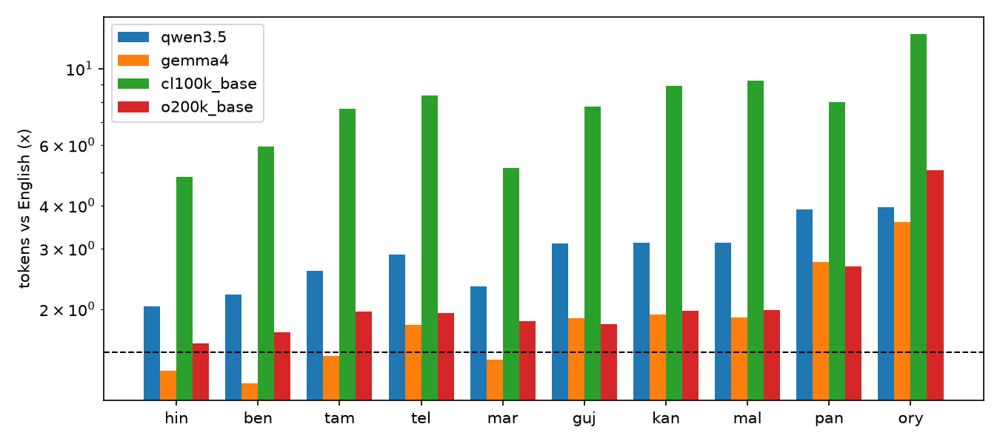
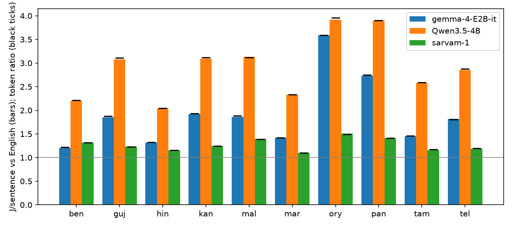
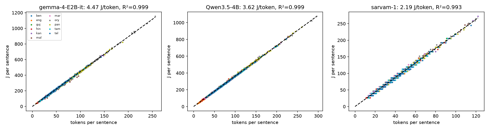

# Energy cost of the tokenizer tax in memory-bound decoding (Indian languages)

**Question.** Subword tokenizers cut Indian-language text into many more tokens than English. Decoding one token costs about the same each time, so does the extra token count turn into an equal extra energy and latency cost per sentence? And does speculative decoding remove that extra cost?

**Short answer, all measured on one NVIDIA T4 (Kaggle), batch size 1:**

- **Yes, energy tracks tokens almost exactly.** Joules per token stays within ±1.2% of English for all 10 Indian languages and all 3 models. The energy ratio to English matches the token ratio to within 1.2%. The worst case is Odia on Qwen3.5-4B: **3.92x** the energy of the same English sentence (3.96x the tokens).
- **The tokenizer sets the size of the tax.** Mean energy ratio over the 10 languages: Qwen3.5-4B 2.91x, Gemma 4 E2B 1.92x, Sarvam-1 1.27x. In absolute terms Sarvam-1 spends 87 J on an average Indian-language sentence, against 232 J for Gemma 4 and 294 J for Qwen3.5-4B. These are different models and I did not measure output quality, so this is a cost comparison, not a recommendation.
- **Speculative decoding saves energy for Indian languages, but its effect on the *gap* is not robust, and its outputs are not always identical to the non-speculative ones.** Details and the honest resume wording are in the M4 section.

Everything below is generated from raw measurements in `results/`. Hypotheses, thresholds and the sentence IDs were fixed before any measurement in [`PREREGISTRATION.md`](PREREGISTRATION.md), and every change is logged there as a dated deviation.

## Method

- **Data.** FLORES+ devtest (parallel sentences, so content is identical across languages). English plus 10 Indian languages (hin, ben, tam, tel, mar, guj, kan, mal, pan, ory). The same 200 sentence indices for every language, chosen by a fixed seed before looking at the data (`sentence_ids.json`).
- **Hardware.** Kaggle Tesla T4, driver 580.178.04, fp16, one of the two GPUs visible to the job. Clocks were not locked.
- **Models.** Qwen3.5-4B, Gemma 4 E2B (`google/gemma-4-E2B-it`) and Sarvam-1 (2.5B, Indic-focused tokenizer). Llama 3.2 was planned, but its gated access form asks for an affiliation and I did not request access; see the deviations log.
- **Energy.** `nvmlDeviceGetTotalEnergyConsumption` (hardware counter, millijoules) read before and after each sentence with `torch.cuda.synchronize()` on both sides. Board energy only (no CPU or RAM). Idle power is measured before each language block; tables use **raw** joules, and idle-subtracted values are in the raw JSON.
- **M3 workload: teacher-forced decoding.** After a short fixed prompt (7 tokens for Qwen3.5 and Gemma 4, 9 for Sarvam-1), the reference sentence's own tokens are fed one at a time through the KV cache. Every language therefore decodes exactly its own tokens, so differences cannot come from the model writing longer or shorter text. Batch size 1, languages in random order, one pass over 200 sentences x 11 languages x 3 models.
- **M2 reliability check.** 3 languages x 20 sentences x 3 repeats per model, on the T4. Repeat medians agreed within 0.2–1.3% for Qwen3.5-4B, and within 0.5–6.2% for Gemma 4 and Sarvam-1 (Tamil 5.6% and 6.2% are slightly above the 5% target). Raw files are in `results/t4/m2_pilot_*.json`.
- **M4 workload: real greedy generation.** Prompt: "Translate the following English sentence into <language>. Output only the translation." (English as a target is translated from Hindi, so the English row is a different task.) Max 160 new tokens, generation stops at the first newline token. 20 sentences x 11 languages x each method, with method order randomised per sentence. Methods: no speculation, prompt-lookup drafting, and a draft model where one exists. The "gap" is the pre-registered quantity: the mean over Indian languages of J/sentence divided by English J/sentence.

### Table 1. Tokens vs English (M1, same 200 sentences)

| language | qwen3.5 | gemma4 | sarvam1 | cl100k_base | o200k_base |
|---|---|---|---|---|---|
| hin | 2.04 | 1.32 | 1.15 | 4.84 | 1.59 |
| ben | 2.21 | 1.22 | 1.32 | 5.93 | 1.72 |
| tam | 2.59 | 1.46 | 1.17 | 7.65 | 1.96 |
| tel | 2.88 | 1.80 | 1.20 | 8.37 | 1.95 |
| mar | 2.33 | 1.42 | 1.10 | 5.14 | 1.85 |
| guj | 3.11 | 1.88 | 1.23 | 7.75 | 1.81 |
| kan | 3.12 | 1.93 | 1.24 | 8.90 | 1.97 |
| mal | 3.12 | 1.89 | 1.39 | 9.22 | 1.99 |
| pan | 3.90 | 2.74 | 1.41 | 8.01 | 2.66 |
| ory | 3.96 | 3.59 | 1.50 | 12.60 | 5.07 |
| langs under 1.5x | 0/10 | 4/10 | 10/10 | 0/10 | 0/10 |

### Table 2. Energy per sentence, ratio to English (M3, T4, batch 1, raw joules; token ratio in brackets)

| language | gemma-4-E2B-it | Qwen3.5-4B | sarvam-1 |
|---|---|---|---|
| hin | 1.32x (1.32x) | 2.05x (2.04x) | 1.16x (1.15x) |
| ben | 1.21x (1.22x) | 2.20x (2.21x) | 1.31x (1.32x) |
| tam | 1.45x (1.46x) | 2.58x (2.59x) | 1.16x (1.17x) |
| tel | 1.82x (1.80x) | 2.85x (2.88x) | 1.19x (1.20x) |
| mar | 1.42x (1.42x) | 2.33x (2.33x) | 1.10x (1.10x) |
| guj | 1.85x (1.88x) | 3.08x (3.11x) | 1.23x (1.23x) |
| kan | 1.92x (1.93x) | 3.09x (3.12x) | 1.25x (1.24x) |
| mal | 1.86x (1.89x) | 3.13x (3.12x) | 1.39x (1.39x) |
| pan | 2.73x (2.74x) | 3.90x (3.90x) | 1.41x (1.41x) |
| ory | 3.59x (3.59x) | 3.92x (3.96x) | 1.51x (1.50x) |
| English J/sentence | 121.1 J | 100.7 J | 68.6 J |

### Table 3. Is joules per token constant? (M3)

| model | parameters | slope J/token | R² | J/token vs English, range over 10 languages | ms/token | bandwidth floor ms (assumption) |
|---|---|---|---|---|---|---|
| gemma-4-E2B-it | 5.10B | 4.466 | 0.9987 | -1.2% to +0.8% | 69.3 | 31.9 |
| Qwen3.5-4B | 4.21B | 3.624 | 0.9991 | -1.0% to +0.6% | 54.6 | 26.3 |
| sarvam-1 | 2.53B | 2.189 | 0.9928 | -1.1% to +0.7% | 33.3 | 15.8 |

### Table 4a. Speculative decoding, all 220 sentences (pre-registered analysis)

| model | method | sentences | acceptance | J/sentence change, Indian | J/sentence change, English | gap reduction % (95% CI) | outputs identical to baseline |
|---|---|---|---|---|---|---|---|
| gemma-4-E2B-it | draft | 220 | 0.25 | -45% | -28% | +23.9 (+13.4 to +31.6) | 206/220 |
| gemma-4-E2B-it | prompt_lookup | 220 | 0.43 | -60% | -9% | +55.8 (+46.9 to +62.2) | 202/220 |
| Qwen3-4B | draft | 220 | 0.33 | +66% | +273% | +55.5 (+40.1 to +65.1) | 181/220 |
| Qwen3-4B | prompt_lookup | 220 | 0.06 | -23% | -4% | +19.6 (+15.1 to +23.6) | 205/220 |
| sarvam-1 | prompt_lookup | 220 | 0.09 | -7% | -1% | +6.1 (-0.8 to +12.6) | 201/220 |

### Table 4b. Speculative decoding, sensitivity: only sentences whose baseline output ended naturally

| model | method | sentences | acceptance | J/sentence change, Indian | J/sentence change, English | gap reduction % (95% CI) | outputs identical to baseline |
|---|---|---|---|---|---|---|---|
| gemma-4-E2B-it | draft | 172 | 0.18 | -24% | -28% | -5.4 (-18.7 to +6.8) | 159/172 |
| gemma-4-E2B-it | prompt_lookup | 172 | 0.25 | -33% | -9% | +26.2 (+13.1 to +36.0) | 159/172 |
| Qwen3-4B | draft | 71 | 0.34 | +80% | +275% | +51.9 (+35.4 to +63.1) | 42/71 |
| Qwen3-4B | prompt_lookup | 71 | 0.06 | -17% | -4% | +13.4 (+6.3 to +19.6) | 62/71 |
| sarvam-1 | prompt_lookup | 216 | 0.05 | -2% | -1% | +0.9 (-4.6 to +5.7) | 197/216 |


## Figures


*Figure 1. Tokens vs English per language and tokenizer (log scale, dashed line = 1.5x).*


*Figure 2. Joules per sentence vs English (bars) against the token ratio (black ticks), per model.*


*Figure 3. Joules per sentence against tokens per sentence, every sentence in every language. The dashed line is the fit; its slope is joules per token.*

## Verdict on each pre-registered hypothesis

- **H1 (token tax above 1.5x for most languages): falsified by its own rule.** The pre-registered rule said H1 is falsified if the best tokenizer is under 1.5x for most languages. Sarvam-1 is under 1.5x for all 10. It is an Indic-specialised tokenizer that I added after Llama failed, and I report it as is. For the two general-purpose model families the tax is real: Qwen3.5 is 2.0–4.0x (0/10 under 1.5x) and Gemma 4 is 1.2–3.6x (4/10 under 1.5x). The reference tokenizers reproduce the earlier paper's pattern (cl100k_base up to 12.6x, o200k_base up to 5.1x, both for Odia).
- **H2 (joules per token roughly constant, R² at least 0.9): supported.** R² is 0.993 to 0.999. Joules per token is within -1.2% to +0.8% of English.
- **H3 (energy ratio within 15% of the token ratio): supported.** The ratio of the two ratios is 0.988 to 1.008 across all languages and models. Latency ratios agree equally closely (see `results/analysis_m3.json`).
- **H4 (the tax differs by model family): supported.** Odia is 3.92x, 3.59x and 1.51x on Qwen3.5, Gemma 4 and Sarvam-1.
- **H5 (speculative decoding widens the gap): not supported.** See the M4 section.

## M4: what speculative decoding did

- **Gemma 4 E2B with Google's 78M-parameter draft model (Google's official multi-token-prediction drafter).** On all 220 sentences, energy per sentence fell 45% for Indian languages and 28% for English, and the gap shrank by 23.9% (95% CI 13.4 to 31.6). On the 172 sentences whose baseline output ended naturally, energy still fell (24% Indian, 28% English) but the gap change was -5.4% (CI -18.7 to +6.8), which is not distinguishable from zero. So the gap result depends on which sentences are included.
- **Acceptance rate was not lower for Indian languages on Gemma 4** (0.25 Indian mean vs 0.16 English), which goes against the earlier paper. The highest value, Odia at 0.66, may come from repetitive output; this is a guess, because the generated text was not saved and I did not inspect it. On Qwen3-4B with a 0.6B draft model, acceptance was lower for Indian languages (0.33 vs 0.51), matching that paper, but the draft model **raised** energy by 66% (Indian) and 273% (English). Its apparent 55% "gap reduction" is an artifact of English getting far more expensive, which is why Table 4 shows the absolute energy changes next to the gap.
- **Prompt-lookup drafting (no draft model) was the larger saving on Gemma 4:** -60% Indian and -9% English energy, a 55.8% gap reduction (CI 46.9 to 62.2), and still -33% Indian energy with a 26.2% gap reduction on the clean subset. Prompt-lookup works best when the output repeats earlier text, and long outputs that hit the length cap may repeat; I did not inspect the generated text (it was not saved), so treat these savings with that caution. On Sarvam-1 it saves 7% for Indian languages (gap change +6.1%, CI -0.8 to +12.6, not significant). On Qwen3-4B it saves 23%.
- **Qwen3.5-4B cannot use assisted generation in Hugging Face** (it is a stateful hybrid-attention model: "assisted generation is not supported with stateful models"). Its M4 run produced almost-empty outputs (214 of 220 outputs were 1–2 tokens) and is excluded; the raw file is kept as `results/t4/m4_qwen35_4b_INVALID_degenerate_outputs.json`.
- **Outputs are not always identical to the baseline.** Under greedy decoding, speculation should reproduce the target's output, but fp16 batched verification differs numerically from one-token steps. Matching outputs: Gemma 4 draft model 206 of 220 (94%), prompt-lookup 202 of 220; Qwen3-4B draft model 181 of 220 (82%); Sarvam-1 prompt-lookup 201 of 220. The claim "exact target outputs" is therefore not supported by these data.
- **Which approach reduces energy for Indian languages?** On Gemma 4, prompt-lookup beat the draft model. Choosing a low-tax tokenizer (Sarvam-1) gave the lowest absolute energy per Indian-language sentence by a wide margin (87 J on average, against 232 J and 294 J, from `results/analysis_m3.json`), but I did not measure quality, so that is a cost result only.

### Replacement wording for the resume bullet

The draft bullet was: "Reduced the energy gap by X% with speculative decoding using a N-parameter draft model, preserving exact target outputs". The measured facts do not support "preserving exact target outputs", and the gap reduction is not robust. Wording that matches the data:

> Measured GPU energy per sentence for Indian-language decoding on a T4 across three model families: energy scales with token count (R² ≥ 0.99), reaching 3.9x English for Odia on Qwen3.5-4B. With a 78M-parameter draft model on Gemma 4 E2B, speculative decoding cut Indian-language decode energy by 45% (English 28%) with greedy outputs matching the baseline on 94% of sentences; the narrowing of the Indian/English energy gap (24%, 95% CI 13–32%) did not hold on cleanly terminated outputs.

## Limitations

- **One GPU type, one Kaggle machine, one pass.** M3 is a single pass; only the M2 reliability check has repeats. Kaggle machines are shared; I cannot rule out neighbours, and the SM clock varied between 1050 and 1485 MHz at up to 81 °C because clocks were not locked.
- **Idle power is large.** The T4 idled at about 36 W in my measurement, so idle subtraction removes about half the energy of an English sentence. Raw and idle-subtracted ratios differ slightly (for example Odia on Qwen3.5: 3.92x raw, 3.74x idle-subtracted). I report raw as primary; the idle-power estimate is a 5-second sample before each language block, an assumption rather than an exact baseline.
- **Counter resolution.** The NVML energy counter does not update on very short windows. Sarvam-1's prefill-only energy reads 0.00 J for a 38 ms window, and Sarvam-1's scatter plot is visibly stepped, which is why its R² (0.993) is the lowest. Sentence-level energy for short sentences is therefore quantised.
- **Not memory-bound in the strict sense.** Measured time per token is 33 to 69 ms. The bandwidth floor (weights size divided by 320 GB/s, the published T4 spec; an assumption, not measured) is 16 to 32 ms, so decoding runs about 2.1–2.2x above the floor on all three models. I did not profile the cause; it is probably framework and kernel-launch overhead. Qwen3.5 also ran with a slow reference path for `causal_conv1d`. The linear energy-vs-tokens result holds regardless, but the label "memory-bound" is not demonstrated here.
- **M4 prompt quality.** I used a plain prompt without chat templates, and did not evaluate translation quality. Many outputs ran to the 160-token cap (22% for Gemma 4, 46% for Qwen3-4B) and 21% of Qwen3-4B outputs were 1–2 tokens. That is why the clean-subset analysis is reported next to the full one. M4 used 20 sentences per language, not 200, to fit GPU time.
- **M4 English row is a different task** (Hindi to English), so gap numbers mix task and language.
- **Gemma 4's draft model needed a workaround.** transformers 5.23 rejects Google's MTP draft model at load time, so `src/compat.py` patches one config check. Qwen3-4B (a different model generation, with a different tokenizer) was used for the draft-model test only because Qwen3.5 cannot do assisted generation, so its M4 rows are not comparable with its M3 rows.
- **Batch size 1 only**, no longer contexts, no quantisation, and fp16 only (T4 has no bf16).
- **Software versions** come from the stage-1 Kaggle job (`summary.json`); later jobs ran `pip install -U`, so patch versions may differ.
- **A first local smoke test on an RTX 3050 laptop GPU** (`results/m2_*local*.json`, `m2_pilot_qwen2b.json`) is kept only as a development record. It is not a T4 result and is not used in any table.

## Reproduce

On a Kaggle notebook with a T4, GPU and internet on, and FLORES+ terms accepted with `HF_TOKEN` set:

```bash
git clone <this repo> && cd indic-decode-energy && bash run_all.sh
```

`run_all.sh` writes raw results to `results/t4/` and regenerates the analysis files and tables. About 8 GPU hours on a T4 in total. I ran these same commands as three separate Kaggle jobs (the queue and the 12 h session limit made one long job impractical), not as the single script, so `run_all.sh` itself has not been run end to end.

## Repository map

| path | what |
|---|---|
| `PREREGISTRATION.md` | hypotheses, thresholds, sentence-ID rule, dated deviations |
| `src/m1_tokens.py`, `src/data.py` | token counts, FLORES loader |
| `src/energy.py`, `src/decode.py`, `src/m2_pilot.py` | NVML meter, teacher-forced decoding, M2/M3 runner |
| `src/m4_spec.py`, `src/compat.py` | speculative-decoding runs |
| `src/analyze_m3.py`, `src/analyze_m4.py`, `src/make_tables.py`, `src/build_summary.py` | analysis from raw JSON |
| `results/t4/` | raw measurements (every sentence, every run) |
| `results/summary.json` | headline numbers, hardware and software versions |
| `EXPLAIN.md` | plain-English walkthrough and a 10-question quiz |
| `kaggle/` | notebook builder used to run on Kaggle |
